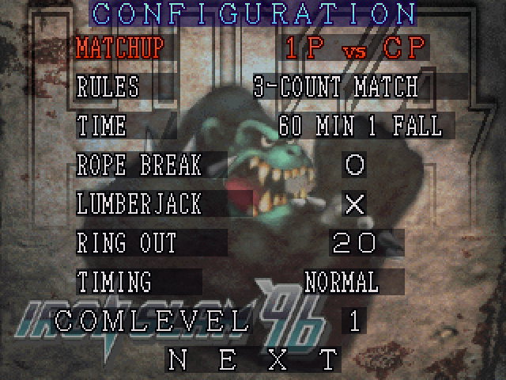
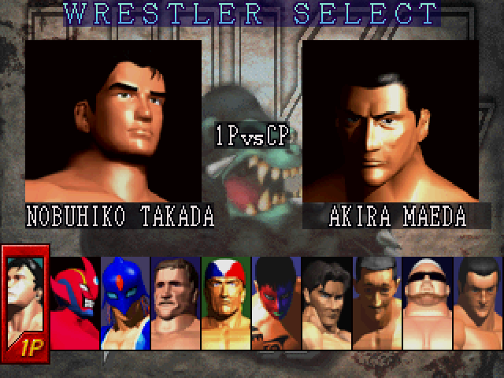
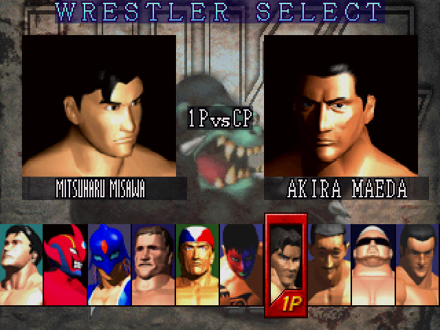
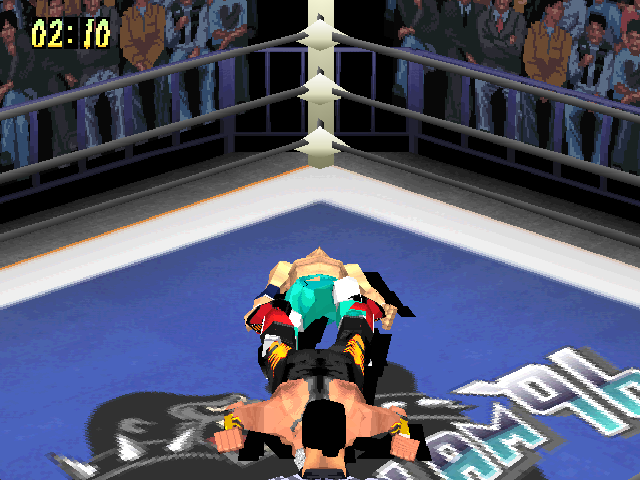
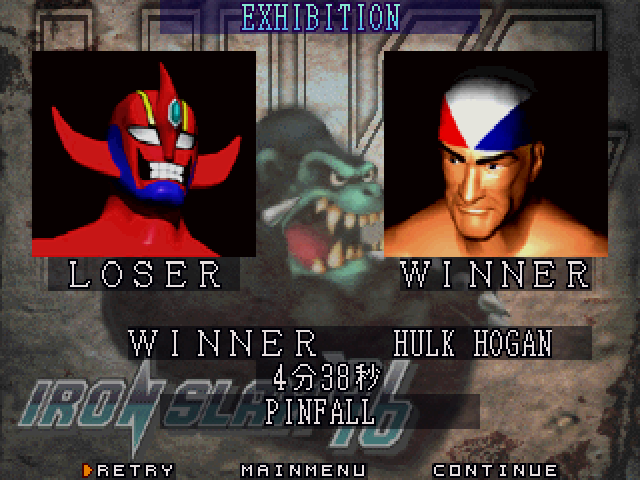
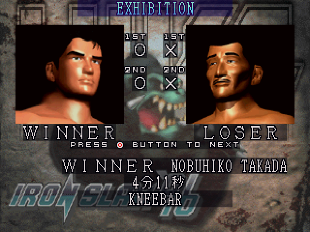
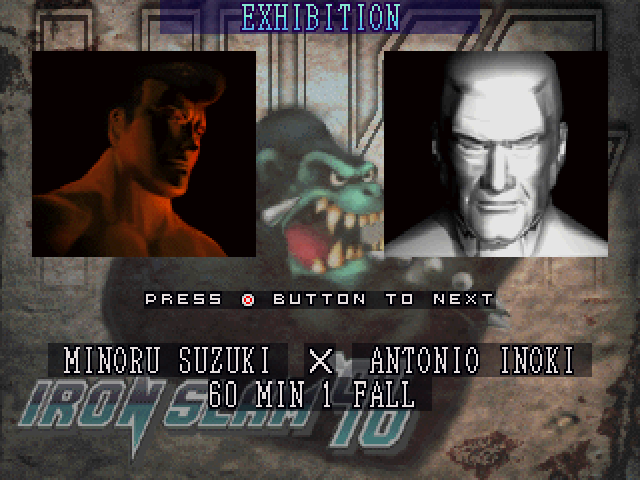
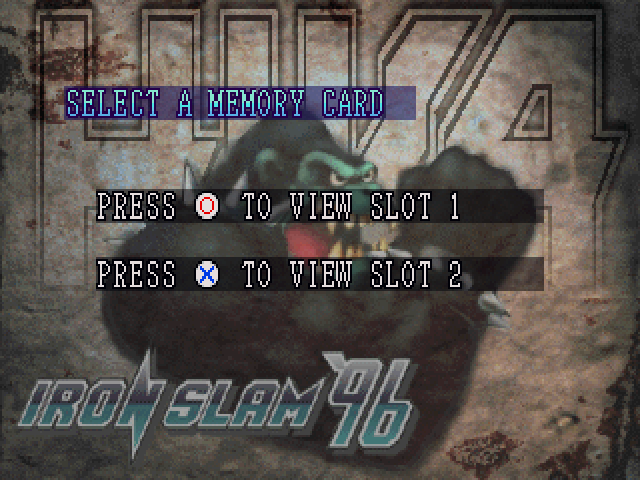

# Screenshots

Fire Pro Wrestling Iron Slam 96 with the English patch, taken in DuckStation. Made with `tools/shots.py`
(docs/RELEASING.md, step 3).

## Match settings

Every option and value in English, drawn with the game's own font.

## Wrestler select

The characters carry the names of the real wrestlers they parody, centred under each portrait.

## Long names

Names too long for the game's 16-pixel letters are drawn in narrow letters made for the patch.

## In the ring

The match itself: the game's own graphics, unchanged.

## Results

Winner, finishing move and match time. The finish names (71 of them) are translated; the time keeps
the game's Japanese minutes and seconds.

## Rematches

After a rematch, the results screen keeps a tally of each bout.

## The hidden bosses

Minoru Suzuki and Antonio Inoki, selectable from the start with the bosses-unlocked patches.

## Memory card

The memory card prompts are translated, with the controller button icons kept. Saves are untouched.
